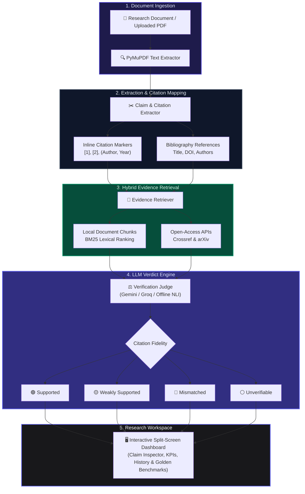

# CiteGuard AI — Claim-to-Source Citation Verifier

> INFINITY AI FORGE Hackathon 2026 entry built for the Claim-to-Source Citation Verifier challenge. An intelligent academic auditing workspace designed to inspect research text, verify inline citations against source evidence, and classify them into rigorous reliability tiers.

---

## Live Demo & Deployment
* Live Web App: Render Deployment (https://citeguard-ai.onrender.com) (Deployed live as a unified FastAPI service)

---

## Overview & Problem Statement
Researchers, students, and reviewers often struggle with academic integrity: a bibliography entry can exist while the cited source still fails to support or even contradicts the sentence that refers to it. CiteGuard AI solves this by automating document inspection, matching claims against source PDFs and metadata APIs, and categorizing citation accuracy into four distinct tiers: Supported, Weakly Supported, Mismatched, and Unverifiable.

---

## Upstream Open-Source Extensions
Per Hacktoberfest rules, this project meaningfully extends and integrates powerful open-source libraries:
* PyMuPDF (pymupdf/PyMuPDF): Used for lightning-fast PDF text extraction and structural parsing.
* rank-bm25 (dorianbrown/rank_bm25): Implements lexical BM25 evidence retrieval over chunked documents.
* FastAPI & Tailwind CSS: Powering a high-performance, single-service web application framework.

---

## Architecture & System Workflow



### Pipeline Breakdown

| Stage | Component | Technical Approach |
| :--- | :--- | :--- |
| **1. Ingestion** | Document & PDF Parser | Extracts clean text using `PyMuPDF` with layout preservation and section boundary detection. |
| **2. Extraction** | Claim & Citation Linker | Matches bracketed (`[1]`, `[1-3]`) and parenthetical (`Author, 2024`) inline citations to entries in the References section. |
| **3. Retrieval** | Hybrid Evidence Retriever | Tokenizes source texts into sentence chunks with `rank-bm25` lexical ranking; queries Crossref and arXiv REST APIs when local texts are unavailable. |
| **4. Verification** | 4-Tier Classification Judge | Evaluates claim fidelity using Gemini 2.5 Flash / Groq LLaMA 3.3 with deterministic offline heuristic fallback. Classifies into **Supported**, **Weakly Supported**, **Mismatched**, or **Unverifiable**. |
| **5. Workspace** | Split-Screen UI | Renders claims alongside cited source passages, side-by-side claim inspector, reliability badges, and audit history. |

---

## Repository Structure

```text
citeguard-ai/
├── .gitignore
├── README.md
├── requirements.txt
├── render.yaml
├── app/
│   ├── __init__.py
│   ├── main.py              # FastAPI endpoints & static file mounting
│   ├── database.py          # SQLite persistence, PBKDF2 auth & email verification OTPs
│   ├── extractor.py         # PDF text parsing & citation marker mapping
│   ├── retriever.py         # BM25 local retrieval & Crossref/arXiv fetcher
│   ├── verifier.py          # Open-weight LLM judge (4-class classification)
│   └── benchmark_data.json  # Golden test dataset for evaluation
├── static/
│   ├── index.html           # Tailwind CSS academic audit dashboard UI
│   ├── app.js               # Frontend fetch handlers, state, & UI renderers
│   └── style.css            # Custom CSS styling, glassmorphism, & animations
└── tests/
    ├── test_verifier.py     # Core claim extraction & verifier test suite
    └── test_auth_security.py # Authentication, email OTP, & uniqueness test suite
```

---

## Security & Authentication Features

CiteGuard AI includes a built-in, zero-external-dependency authentication and security subsystem powered by SQLite and PBKDF2-HMAC-SHA256:

* **Strict Credential Uniqueness**: Username and email address uniqueness is strictly enforced at both the application level and the database level with case-insensitive unique indexes (`LOWER(username)`, `LOWER(email)`).
* **Format & Deliverability Validation**:
  * Usernames must be 3–30 characters long, alphanumeric with hyphens and underscores (`^[a-zA-Z0-9][a-zA-Z0-9_-]{2,29}$`).
  * Emails are validated against RFC syntax and verified for **active DNS deliverability** (`socket.getaddrinfo`), preventing invalid, misspelled, or fake domains (e.g. `@fake123xyz.com`) from registering.
  * Passwords enforce a minimum of 8 characters with a real-time 3-stage visual strength meter (Weak / Medium / Strong).
* **Real-Time Availability & Domain Feedback**: Form inputs feature a 320ms debounced live availability check (`/api/check-availability`) providing instant validation indicators for both username uniqueness and email domain validity before form submission.
* **Email Authentication & Live OTP Dispatch**:
  * Each newly registered researcher account generates a cryptographically secure 6-digit OTP code (`secrets.randbelow(900000) + 100000`) with a 15-minute expiration timestamp.
  * **Live SMTP Email Delivery**: When SMTP environment variables are configured (Gmail, SendGrid, Brevo, AWS SES, etc.), CiteGuard sends a rich, responsive HTML email directly to the user's inbox with the 6-digit verification code.
  * **Interactive Demo Mode**: When running locally without SMTP credentials configured, CiteGuard runs gracefully in demo mode, displaying the code on screen with an instant "Auto Fill" chip so the app remains 100% testable out-of-the-box.
  * 30-second countdown timer on the "Resend Code" button to prevent rate abuse.
  * Verified accounts display a green `Verified` badge in the header profile pill.
* **Persistent Audit History**: Signed-in users have their past document inspections automatically saved to SQLite, accessible via the Sessions drawer and History tab.

---

## API Endpoints

### Verification & Core Engine
| Method | Endpoint | Description |
| :--- | :--- | :--- |
| `GET` | `/api/health` | Service health status check |
| `GET` | `/api/sample` | Pre-built demonstration paper with all 4 citation verdicts |
| `POST` | `/api/extract-pdf` | PyMuPDF structural text extraction from uploaded PDF |
| `POST` | `/api/fetch-url` | Query Crossref & arXiv APIs for external publication metadata |
| `POST` | `/api/verify` | Full claim extraction, BM25 retrieval, and verification judge |
| `GET` | `/api/benchmark` | 12-case benchmark evaluation with precision, recall, & F1 metrics |

### Authentication & Account Security
| Method | Endpoint | Description |
| :--- | :--- | :--- |
| `GET` | `/api/email-status` | Check whether SMTP is configured for live email delivery |
| `GET` | `/api/check-availability` | Check username or email availability in real-time |
| `POST` | `/api/register` | Register user account with PBKDF2 hash & generate 6-digit email OTP |
| `POST` | `/api/login` | Authenticate credentials and return session bearer token |
| `GET` | `/api/me` | Fetch active user profile including email verification status |
| `POST` | `/api/verify-email` | Validate 6-digit OTP code and activate researcher account |
| `POST` | `/api/resend-verification` | Generate and dispatch a fresh 6-digit OTP code |
| `POST` | `/api/logout` | Invalidate and purge active session token |
| `GET` | `/api/history` | List user's saved verification audit sessions |
| `GET` | `/api/history/{id}` | Load specific past audit report into Inspector |
| `DELETE` | `/api/history/{id}` | Delete a saved audit record |

---

## Local Setup & Installation

### 1. Clone the Repository
```bash
git clone https://github.com/sigmasajan/citeguard-ai.git
cd citeguard-ai
```

### 2. Create & Activate Virtual Environment
```bash
python3 -m venv venv
source venv/bin/activate  # On Windows: venv\Scripts\activate
```

### 3. Install Dependencies
```bash
pip install -r requirements.txt
```

### 4. Configure Environment Variables
Create a `.env` file from `.env.example`:
```bash
cp .env.example .env
```
Add your optional LLM API key and optional live SMTP configuration:
```env
# Optional LLM Judge Keys
GEMINI_API_KEY=your_gemini_api_key_here
GROQ_API_KEY=your_groq_api_key_here

# Optional Live Email Dispatch (Gmail, SendGrid, Brevo, AWS SES)
# If omitted, CiteGuard operates in Demo Mode displaying codes on-screen.
SMTP_HOST=smtp.gmail.com
SMTP_PORT=587
SMTP_USER=your_email@gmail.com
SMTP_PASSWORD=your_16_char_google_app_password
SMTP_FROM=CiteGuard AI <your_email@gmail.com>
```

### 5. Run the Local Server
```bash
uvicorn app.main:app --reload --port 8000
```
Open your browser and navigate to `http://localhost:8000`.

---

## Running Automated Tests

To run the complete test suite (both verifier logic and authentication security):
```bash
pytest -v
```
